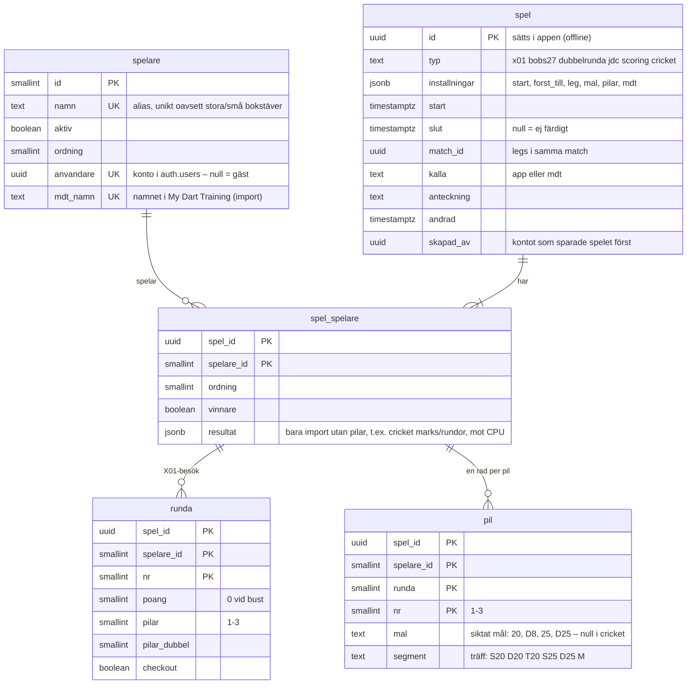

# Datamodell – schemat `dart`

Supabase-projektet `tht`, schemat `dart`. Originalet är `supabase/01_schema.sql` och `02_vyer.sql`; en kopia av den här sidan finns i Obsidian (`Darttränaren - Datamodell`).

## Konton och behörighet (04_konton.sql)
Var och en har ett eget konto med rollen `dart` i `app_metadata`, kopplat till sin rad i `spelare` (`anvandare`). Spelare utan konto är gäster.
- **Läsa:** alla i gruppen läser allt (policy `dart_las`).
- **Spel:** ändras bara via `spara_spel`/`ta_bort_spel` (security definer). De släpper igenom nya spel, spel man själv skapat och spel där man själv är med (`far_andra`). Direkt skrivning i `spel`, `spel_spelare`, `runda` och `pil` är avstängd.
- **Spelare:** alla får lägga till gäster; en spelare med konto ändras bara av ägaren. Inloggade får bara ändra `namn` och `aktiv` (05_alias.sql) – ingen kan koppla om konton. Ingen tar bort spelare.
- **Alias:** `namn` får inte krocka med någon annans, oavsett stora/små bokstäver (index `spelare_namn_unik`). Importen hittar spelarna på `mdt_namn`, så alias kan bytas fritt.

## Funktioner
- `dart.spara_spel(p jsonb)` – sparar ett helt spel i en transaktion. Idempotent: samma id skriver över (offlinekön kan skicka flera gånger). Sätter `skapad_av` vid första sparandet.
- `dart.ta_bort_spel(sid uuid)` – tar bort spelet med spelare, rundor och pilar.
- `dart.far_andra(sid uuid)` – får den inloggade ändra spelet?
- `dart.ar_dart()` – sant när JWT:ns `app_metadata.roll` är `dart`. Används i alla RLS-policyer.

## Vyer (security_invoker, följer RLS)
| Vy | Innehåll |
| --- | --- |
| `v_pil` | Varje pil med nummer, multipel och om den träffade målet |
| `v_runda_pil` | Per runda: pilar, träffar, marks, poäng på träff, cricket-marks, shanghai |
| `v_x01` | Per X01-leg och spelare: poäng, pilar, snitt, första 9, dubbelpilar, checkouts, högsta utgång, 100+/140+/180, kvar |
| `v_resultat` | Övningar och cricket per spel och spelare: pilar, träffar, marks, rundor, poäng (Bob's 27, JDC, scoring), MPR |
| `v_mal` | Träff per mål och spelare (dubblar, bull m.m.) |

## Import från My Dart Training
`import/mdt.py` läser `.mdt`-backupen (SQLite). Spel får fasta uuid (uuid5 av tabell och id), så en ny backup kan importeras om utan dubbletter. JDC, Bob's 27 och scoring sparar bara antal träffar per mål i backupen – pilarna återskapas, så ordningen inom ett mål är påhittad (summor och träffprocent stämmer). Cricket har bara summor → `spel_spelare.resultat`.
